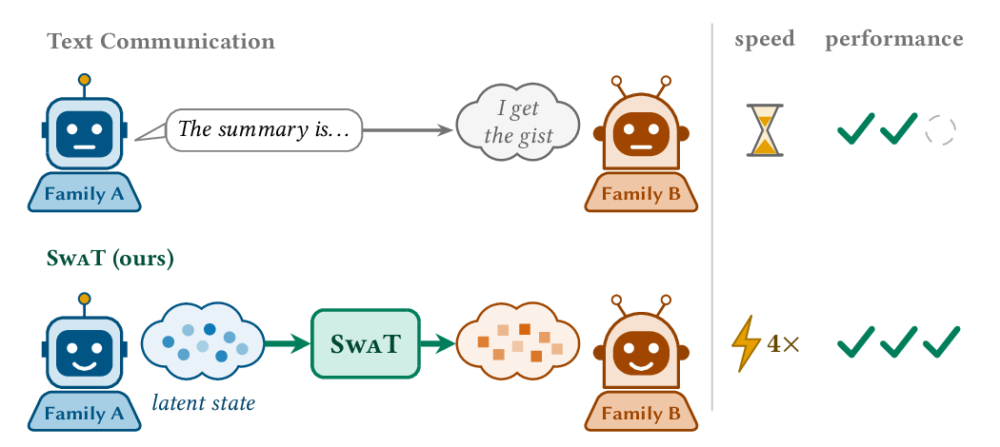
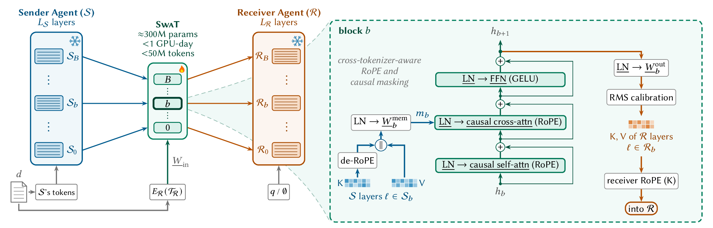
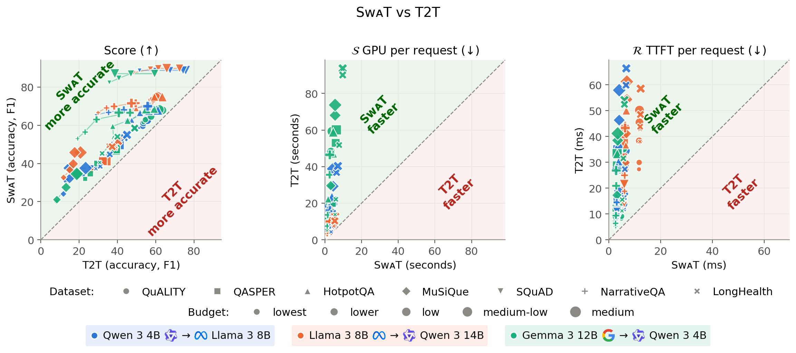
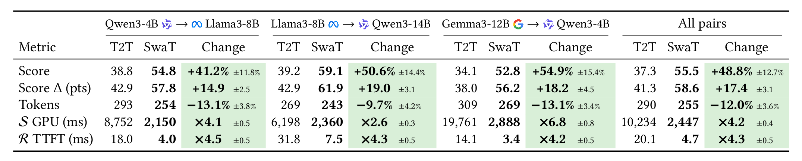

<div align="center">

<h1>🚨SwaT🚨: Swarm Telepathy</h1>
<h3>Prefill-Free KV-Cache Transfer Across Families</h3>

<a href="https://arxiv.org/abs/2610.15095"></a>




</div>

LLM agents usually communicate through text. 
We propose an alternative method: SwaT (Swarm Telepathy) 

SwaT lets two LLMs from different families
communicate through their KV-caches instead. A small learned mapper translates the sender's cache into the
receiver's cache space. The receiver then decodes as if the transferred cache were its own state without
reading (prefilling) the text, as if the two agents had communicated telepathically.

Both models stay frozen. Training a mapper takes under 50M tokens of English text.

## How it works

<p align="center"></p>

We start with the sender prefill (its KV-cache / thoughts). SwaT has B blocks (about 300M parameters in total). Each block b cross-attends
to a group of sender layers' KV-cache and outputs a group of receiver layers' KV-cache. 
Inside a SwaT block, causal self-attention is followed by causal cross-attention on the sender's
de-RoPEd KV-cache, then an FFN. The output is finally projected (+RoPE for keys). 

The sender and receiver tokenize the same text differently, so cross-attention positions and
its causal mask are aligned through each token's character span (equations provided in the paper).

Both models stay frozen. Only SwaT is trained.

### Training objectives

SwaT ($`\underline M_{i\to j}`$) learns to map the sender's prefill cache $`C^{\mathcal S}_d`$ of any input text $`d`$, together with the
receiver's tokens $`\mathcal T_{\mathcal R}`$ of $`d`$, to a predicted receiver cache. It is trained with two losses.

<table>
<tr>
<td width="50%" valign="bottom">

**Loss 1: reconstruction.** A normalized MSE against the receiver's own prefill cache $`C^{\mathcal R}_d`$,
where $`\sigma`$ is the RMS of $`C^{\mathcal R}_d`$ per layer and head, for keys and values separately. Keys are compared
before RoPE.

<div align="center">

$`\displaystyle \mathcal L_{\mathrm{recon}} = \mathrm{MSE}\left(\frac{\underline M_{i\to j}(C^{\mathcal S}_d,\mathcal T_{\mathcal R})}{\sigma},\ \frac{C^{\mathcal R}_d}{\sigma}\right)`$

</div>

</td>
<td width="50%" valign="bottom">

**Loss 2: Negative log-likelihood.** The receiver's next-token loss on a target continuation $`y`$ (an answer or a
reasoning trace) after a task prompt $`q`$, with the transferred cache in place of the text. Gradients pass through the
frozen receiver into SwaT only.

<div align="center">

$`\displaystyle \mathcal L_{\mathrm{NLL}} = -\frac{1}{|y|}\sum_{t=1}^{|y|}\log p_{\mathcal R}\left(y_t \mid \underline M_{i\to j}(C^{\mathcal S}_d,\mathcal T_{\mathcal R}),\, q,\, y_{\lt t}\right)`$

</div>

</td>
</tr>
</table>

Some samples have a long context $`d`$ given to the sender followed by a question $`q`$ given to the receiver, other samples only have a question $`d`$ given to the sender while the receiver has no input text ($`q`$ is empty). 

In either case, the receiver must understand the transferred KV-cache of $`d`$ to properly output a correct answer.

## Results

- **Retention.** On 17 benchmarks across 10 cross-family pairs (6 families, 3B to 32B), a receiver reading SwaT's
  cache keeps over 90% of its own score with the real text, and over 100% when the sender is the larger model.
- **SwaT vs. text.** We combine SwaT with [Attention Matching](https://arxiv.org/abs/2602.16284) (AM) KV-cache
  compaction and compare it against text-to-text summaries (T2T) at matched budgets. On 7 datasets, SwaT+AM is on
  average 40% more accurate and 4× faster, in both sender GPU time and receiver time to first token.
- **Zero-shot transfer.** Although SwaT trains only on English text we notice several sender capabilities being transferred to the receiver. Like a VLM sender giving a text-only LLM 
  receiver vision, or Qwen3 passing its ability to answer Chinese benchmarks/tasks to Llama 3.

<p align="center"></p>

SwaT+AM vs. T2T, averaged over three sender–receiver pairs, seven datasets and five budgets. T2T and SwaT are
geometric means; Change is their ratio. Score Δ is the arithmetic mean score difference in points. Green marks SwaT is statistically better than T2T (95% bootstrap CI).

<p align="center"></p>

## Setup

```bash
cp .env.example .env    # set paths here; needed by code
python3.10 -m venv env3.10 && ./env3.10/bin/pip install -r requirements.txt
```

Download models:

```bash
./env3.10/bin/python scripts/download/download_model.py ibm-granite/granite-3.3-8b-instruct
./env3.10/bin/python scripts/download/download_model.py HuggingFaceTB/SmolLM3-3B
```

Download datasets:

```bash
for d in qasper quality hotpotqa musique longhealth squad narrativeqa boolq race; do
  ./env3.10/bin/python multiagent/dataset/download_hf.py $d
done
./env3.10/bin/python scripts/download/download_eval_datasets.py \
  --dataset arc-c --dataset hellaswag --dataset winogrande --dataset mmlu --dataset gsm8k \
  --dataset medqa --dataset openbookqa --dataset math-500
```

## Get started

### Train a SwaT

To train a SwaT for one sender → receiver pair run `scripts/exp1/run.py`.

The script trains SwaT then evaluates it on 17 benchmarks. The
recipe is in `scripts/exp1/config.json`, and its default pair is Granite-3.3-8B → SmolLM3-3B.

```bash
./env3.10/bin/python scripts/exp1/run.py run --config scripts/exp1/config.json \
  --run multiagent/outputs/exp1_my_pair --gpus 1,2
```

The queue runs these steps:

1. **Traces.** The receiver generates GSM8K reasoning traces, which are filtered for training.
2. **Stage 1.** 5k steps of MSE alignment to the receiver's own cache, on PG-19/WikiText and the QASPER, QuALITY,
   HotpotQA and MuSiQue training splits.
3. **Stage 2.** 24k steps of receiver NLL, adding ARC-C, HellaSwag, WinoGrande, MMLU and the traces. Training uses
   two GPUs: the sender on one, the receiver on the other.
4. **Evaluation.** The receiver (vanilla) and SwaT run on the 17 benchmarks. Vanilla jobs fill idle GPUs while
   training runs.

The trained mapper is `<run>/stage2/exit-checkpoint-24000/renderer.pt`. `<run>/results.json` reports each
benchmark's vanilla score, SwaT score and retention (SwaT / vanilla), plus mean retention overall and per domain.

For another pair, change `sender` and `receiver` in the config. `n-layers` (the number of SwaT blocks).

To see what SwaT does on individual samples, open `multiagent/basic_swat_walkthrough.ipynb`. It loads a trained
pair and takes one benchmark sample through the three steps: the sender prefills the text, SwaT translates the
sender's cache, and the receiver answers from the translated cache without seeing the text. It then compares the
answer with the stored eval.

### SwaT vs T2T

This section compares SwaT+AM against text-to-text communication for one pair, using the SwaT trained in
the previous section.

The script is `scripts/exp2/run.py` and the recipe is in `scripts/exp2/config.json`. Its `renderer` points at the Exp 1 run above, so change it if
your run lives elsewhere.

```bash
./env3.10/bin/python scripts/exp2/run.py run --config scripts/exp2/config.json \
  --run multiagent/outputs/exp2_my_pair --gpus 1,2
```

The queue runs these steps:

1. **Train the query transfer.** AM needs queries in the receiver's space, so a small MLP is trained to map the
   sender's queries to the receiver's. This happens in three steps (`tq_features`, `tq_pairing`, `train_tq`):
   collect aligned query features from both models, pick which sender head feeds each receiver head, then train
   the MLP.
2. **T2T.** On 7 datasets (QuALITY, QASPER, HotpotQA, MuSiQue, SQuAD, NarrativeQA, LongHealth), the sender writes
   summaries of every document under five summary prompts, from very concise to in-depth. The receiver answers
   each question from the summary.
3. **SwaT+AM.** The sender's cache of the same document goes through SwaT, then AM compacts it to the token budget
   of the matching summary. The receiver answers with only the question as text.
4. **Speed.** Both arms are timed on a subset of contexts: sender GPU time per request, and receiver prefill per
   request at batch 16. These steps run one at a time so the measurements don't overlap.

`<run>/results.json` reports, per dataset and summary level, the T2T and SwaT+AM score, tokens communicated,
sender GPU time and receiver prefill time. It also reports means over the datasets by budget and an overall mean,
with the same definitions as the paper's Table 3. Run `scripts/exp2/run.py summarize --run <run>` to rebuild it
at any point.

AM allocates its budget across attention heads using a per-receiver head-budget file from
`multiagent/model/head_budget_optimization/head_budgets/`. For receivers without one, SmolLM3 included, the config
uses `"budget": "uniform"`, which is a weaker AM baseline than the optimized budgets the paper's three pairs use.

## Citation

```bibtex
@misc{alabdulkareem2026swarmtelepathyprefillfreekvcache,
      title={Swarm Telepathy: Prefill-Free KV-Cache Transfer Across Families},
      author={Abdulrahman Alabdulkareem and Irene Tenison and Yang Zhang and Yada Zhu and Boris Katz and Dan Gutfreund},
      year={2026},
      eprint={2610.15095},
      archivePrefix={arXiv},
      primaryClass={cs.LG},
      url={https://arxiv.org/abs/2610.15095},
}
```

## Acknowledgements

SwaT+AM compacts the transferred cache with Attention Matching
([Zweiger et al., 2026](https://arxiv.org/abs/2602.16284)), whose optimized per-head budgets are in
`multiagent/model/head_budget_optimization/head_budgets/`.
